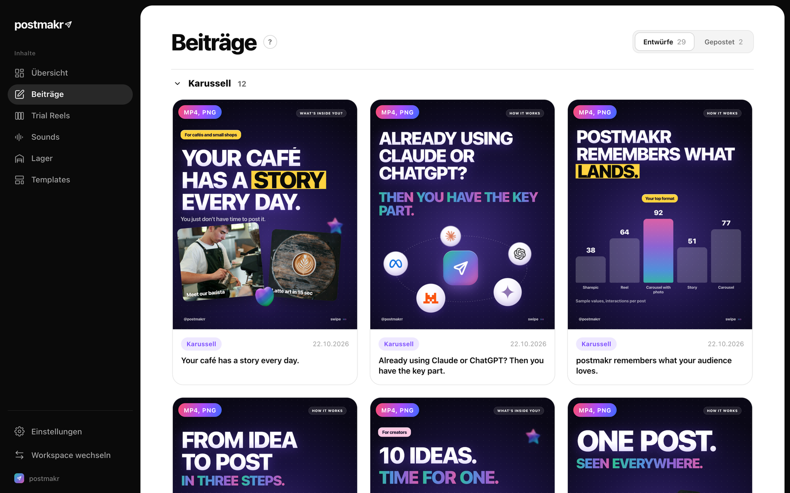
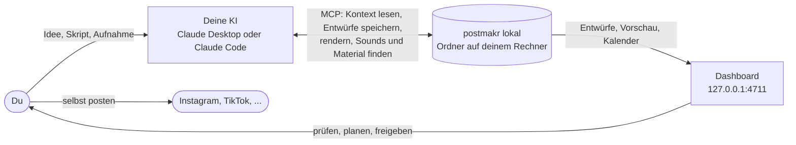
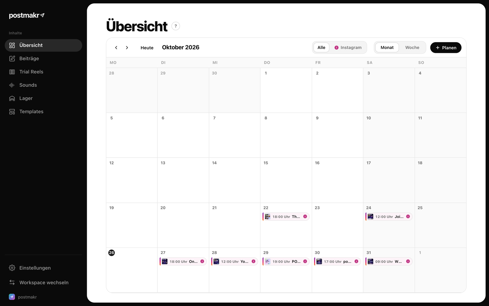
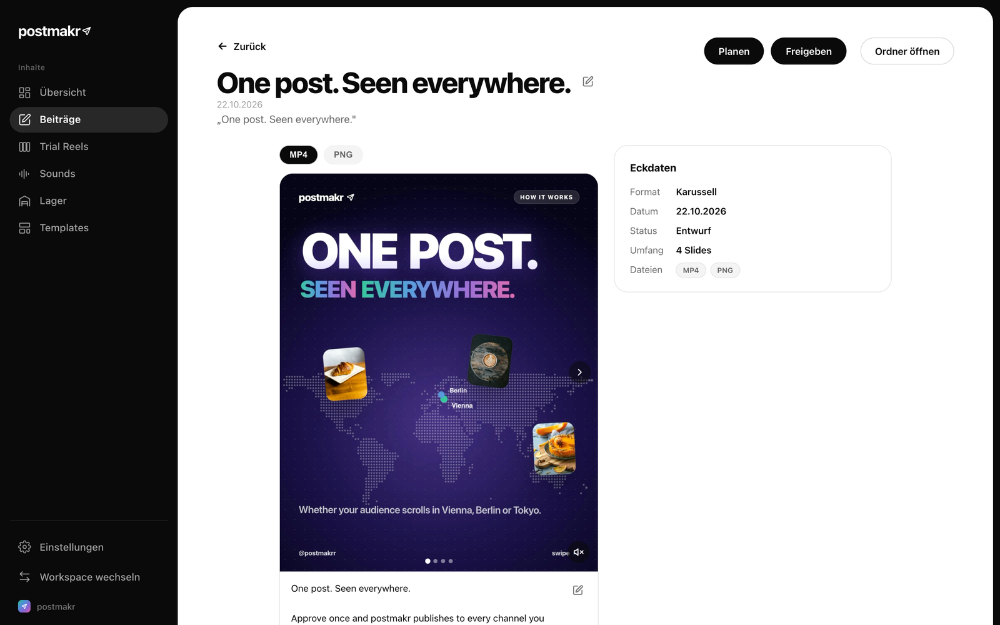
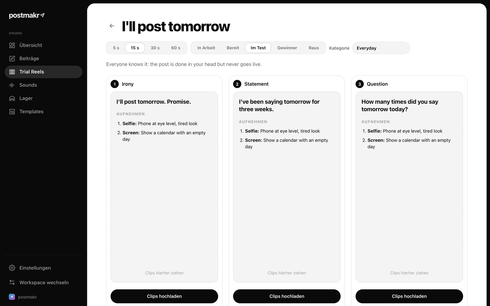
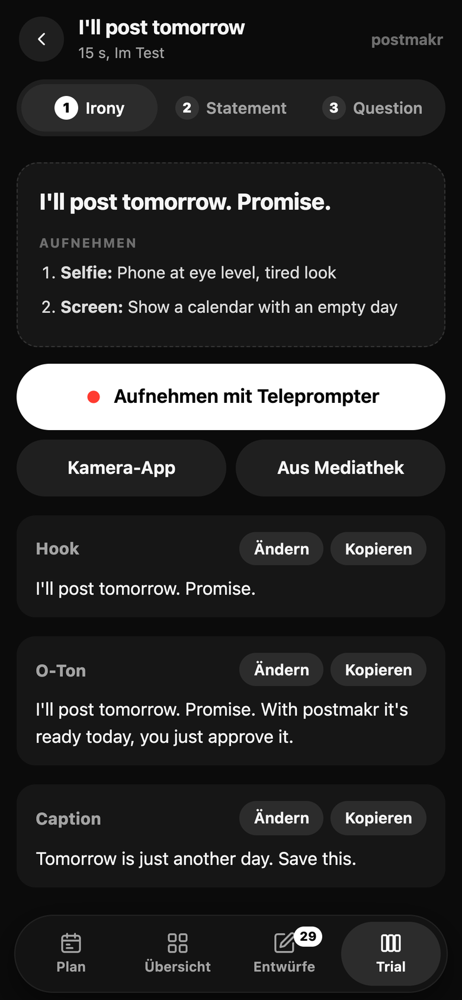
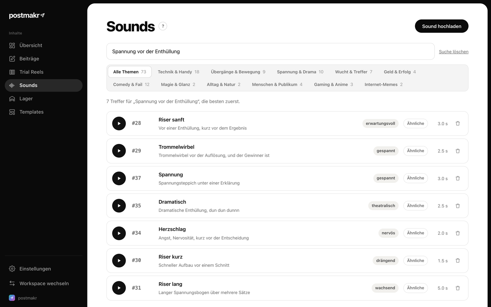
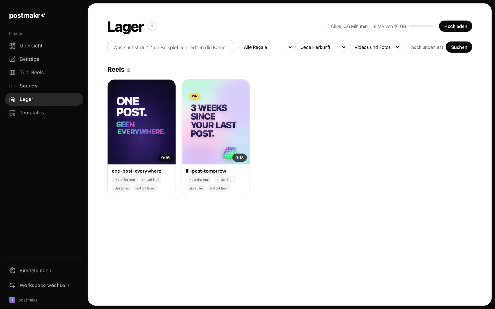
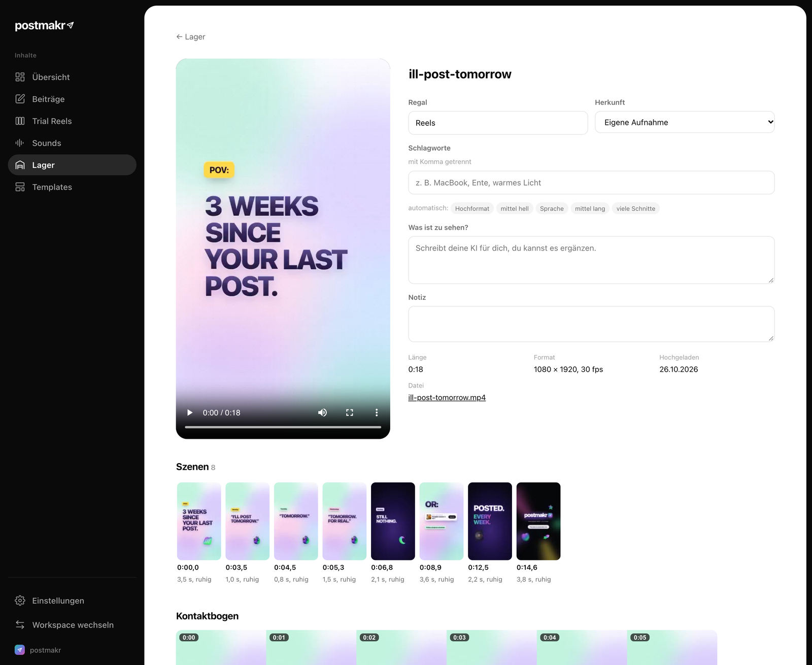
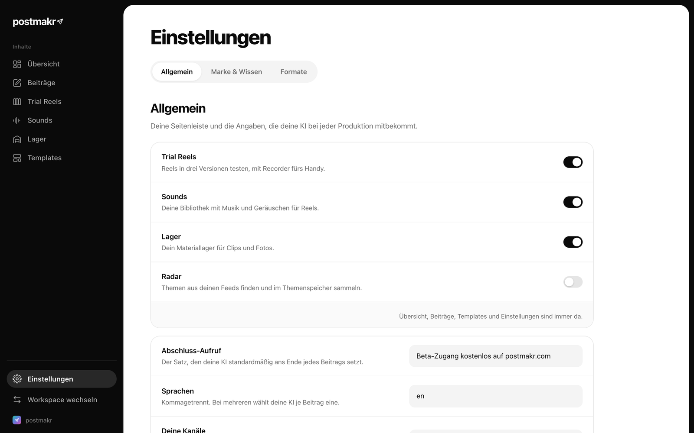

<p align="center">
  
</p>

<h1 align="center">postmakr lokal</h1>

<p align="center">
  Deine KI-Content-Werkstatt auf dem eigenen Rechner.<br>
  Kein Konto, kein Login, keine Cloud. Deine Beiträge und Videos bleiben bei dir.
</p>

<p align="center">
  <a href="LICENSE">AGPL-3.0</a> &nbsp;|&nbsp;
  <a href="docs/ARCHITEKTUR.md">Aufbau</a> &nbsp;|&nbsp;
  <a href="AGENTS.md">Für KI-Agenten</a> &nbsp;|&nbsp;
  <a href="mcp_server/README.md">Claude verbinden</a> &nbsp;|&nbsp;
  <a href="#english-summary">English</a>
</p>

---

postmakr lokal ist der Ort, an dem du und deine KI zusammen Social-Media-Beiträge
machen. Deine KI (zum Beispiel Claude) baut Karussells, Sharepics und Reels über
den mitgelieferten MCP-Server direkt in deinen Ordner. Du siehst alles im
Dashboard, prüfst, planst im Kalender und gibst frei. Gepostet wird von dir,
postmakr lokal hat bewusst keine Anbindung an Kanäle.

## Schnellstart

```bash
git clone https://github.com/taaso/postmakr.git
cd postmakr
./postmakr installieren      # Python-Umgebung, Pakete, Render-Browser
./postmakr start             # Dashboard auf http://127.0.0.1:4711
```

Dann im Browser http://127.0.0.1:4711 öffnen, einen Workspace anlegen und deine
KI verbinden (siehe [Claude verbinden](#claude-verbinden)). Unter Windows
ersetzt du `./postmakr` durch `python postmakr.py`.

## So arbeitet ihr zusammen



Mehr zum inneren Aufbau, mit Grafiken zu allen Abläufen und zum Datenordner,
steht in [docs/ARCHITEKTUR.md](docs/ARCHITEKTUR.md).

## Was postmakr lokal kann

### Kalender und Übersicht
Alle geplanten und geposteten Beiträge auf einen Blick. Du planst per Klick
oder Ziehen, und gepostete Beiträge markierst du von Hand.



### Beiträge prüfen und freigeben
Deine KI legt Entwürfe als HTML-Slides an, postmakr rendert sie zu PNG und MP4.
Auf der Detailseite siehst du Slides, Caption und Eckdaten und gibst mit einem
Klick frei.



### Trial Reels mit Recorder und Teleprompter
Teste ein Reel in drei Versionen mit verschiedenen Hooks. Die KI schreibt Hook,
O-Ton, Caption und Aufnahmeplan, du nimmst direkt im Browser auf, auch am Handy
mit Teleprompter.



<p align="center"></p>

### Sound-Bibliothek mit Suche nach Bedeutung
Du füllst die Bibliothek mit deinen eigenen Sounds. Gesucht wird nach
Stichwort, Bedeutung („Spannung vor der Enthüllung“) oder Klang, und „Ähnliche“
findet Alternativen. Die KI schlägt mit `suggest_sounds` passende Sounds für
jede Stelle eines Skripts vor.



### Materiallager mit Bild- und Bedeutungssuche
Lade Fotos und Videos hoch. postmakr erkennt Szenen, macht Vorschau und
Kontaktbogen, transkribiert Gesprochenes und findet Stellen über ihren
Bildinhalt. Die KI holt sich mit `use_footage` genau den Ausschnitt, den sie
braucht.





### Hörcheck für fertige Reels
`check_reel_sound` hört einen fertigen Schnitt an und meldet Soundeffekte, die
zu spät kommen, zu leise sind oder mitten in einem Wort liegen, mit konkreter
Korrektur („0,18 s nach vorne“).

### Einstellungen
Bereiche der Seitenleiste ein- und ausschalten, Marke und Wissen pflegen,
Formate verwalten.



## Was postmakr lokal nicht ist

postmakr lokal postet nichts auf Kanäle, sammelt keine Statistiken und hat
keinen Login. Wenn du Beiträge automatisch veröffentlichen oder Zahlen
abholen willst, baust du dir diese Anbindung selbst. Die Andockstelle dafür
ist `platform_app/veroeffentlichen.py`, sie wird nach jeder Freigabe
aufgerufen.

## Voraussetzungen

- Python 3.10 oder neuer
- ffmpeg (für Videos, Recorder-Export und Hörcheck).
  Mac: `brew install ffmpeg`, Linux: `sudo apt install ffmpeg`,
  Windows: `winget install ffmpeg`
- Etwa 1 GB Platz für die Grundausstattung. Mit den Extras kommen etwa
  1 GB Pakete und beim ersten Gebrauch die Modelle dazu: etwa 3 GB für die
  Suche nach Bild und Bedeutung und etwa 1,5 GB für den Hörcheck.

## Installation

```
git clone https://github.com/taaso/postmakr.git
cd postmakr
./postmakr installieren
```

Das legt eine eigene Python-Umgebung im Ordner `.venv` an, installiert die
Grundausstattung und den Browser für das Rendern. Danach fragt es, ob du die
Extras willst (Suche nach Bild und Bedeutung, Transkripte, Hörcheck). Du
kannst das auch direkt sagen: `./postmakr installieren --extras` oder
`--ohne-extras`. Ohne Extras läuft alles andere, die Suche arbeitet dann mit
Stichworten.

Unter Windows ersetzt du `./postmakr` überall durch `python postmakr.py`.

## Start

```
./postmakr start
```

Das prüft Python, ffmpeg und den Render-Browser, legt beim ersten Mal den
Datenordner an und startet das Dashboard. Den ersten Workspace legst du im
Browser an. Öffne
dann im Browser die Adresse, die im Terminal steht:
**http://127.0.0.1:4711**. Beenden mit Strg+C.

Standardmäßig ist das Dashboard nur auf deinem Rechner erreichbar, niemand
sonst im Netz sieht es.

## Claude verbinden

postmakr lokal bringt einen MCP-Server mit, über den Claude deine Workspaces
lesen und Beiträge bauen kann. Starte ihn mit `./postmakr mcp`. Wie du ihn
in Claude einträgst, steht in [mcp_server/README.md](mcp_server/README.md).

## Was die KI damit tun kann

Der MCP-Server bringt 27 Tools mit. Die wichtigsten:

| Bereich | Tools |
|---|---|
| Workspaces | `list_workspaces`, `create_workspace`, `get_workspace_context` |
| Abläufe | `start_create`, `start_revise`, `start_approve`, `start_scan_review` |
| Beiträge | `list_drafts`, `read_draft`, `save_draft`, `approve_post`, `archive_search`, `get_reference_posts` |
| Rendern | `render_slide`, `start_animation_render`, `check_render_status` |
| Vorlagen | `list_templates`, `create_template`, `create_from_template` |
| Sounds | `find_sounds`, `suggest_sounds`, `index_sounds` |
| Material | `find_footage`, `use_footage` |
| Ton prüfen | `check_reel_sound` |
| Radar | `run_scan`, `get_scan_results` |

## Handy-Zugang

Der Recorder braucht auf dem Handy Kamera und Mikrofon. Das erlauben
Handy-Browser nur über eine sichere Verbindung (HTTPS). Dafür gibt es:

```
./postmakr start --handy
```

Dann passiert Folgendes:

1. postmakr erzeugt einmalig eine eigene kleine Zertifizierungsstelle und
   damit ein Zertifikat für die Adresse deines Rechners im WLAN. Ändert
   sich die Adresse, stellt postmakr beim nächsten Start ein neues aus. Der
   private Schlüssel bleibt im Datenordner unter `.handy/` und ist nur für
   dich lesbar. Die Zertifizierungsstelle gilt nur für Adressen im eigenen
   Netz, sie kann keine Zertifikate für fremde Webseiten ausstellen.
2. Zusätzlich zu http://127.0.0.1:4711 läuft das Dashboard unter
   **https://<adresse-im-wlan>:4712**.
3. Im Terminal erscheint ein QR-Code. Er enthält die Adresse mit einem
   zufälligen Zugangscode.

**Wichtig:** Mit `--handy` ist das Dashboard für alle in deinem WLAN
erreichbar, und es gibt keinen Login. Ohne Zugangscode bekommt niemand
etwas zu sehen, der Code ist aber der einzige Schutz. Gib ihn nicht weiter
und nutze `--handy` nicht in fremden oder öffentlichen Netzen. Mit
`./postmakr start --handy --neuer-code` würfelst du einen neuen Code, alle
bisherigen Geräte sind dann ausgesperrt.

So richtest du das Handy ein (einmalig):

- Öffne auf dem Handy `https://<adresse-im-wlan>:4712/handy/` (steht im
  Terminal). Dort lädst du das Zertifikat herunter und findest die Anleitung.
- **iPhone**: Profil herunterladen, in den Einstellungen unter „Profil
  geladen“ installieren, dann unter Einstellungen > Allgemein > Info >
  Zertifikatsvertrauenseinstellungen „postmakr lokal“ einschalten.
- **Android**: Die Datei unter Einstellungen > Sicherheit > Verschlüsselung
  und Anmeldedaten > Zertifikat installieren > CA-Zertifikat auswählen.
  Chrome vertraut ihm danach.
- Danach den QR-Code aus dem Terminal scannen. Das Handy merkt sich den
  Zugang 30 Tage lang.

Geht es auch ohne Zertifikat? Du kannst die Warnung im Browser wegklicken.
Nach dem Quelltext von Safari zählt eine HTTPS-Seite auch dann als sicher,
also sollten Kamera und Mikrofon grundsätzlich funktionieren. Auf einem
iPhone getestet ist das aber nicht, Safari fragt immer wieder nach, und es
gibt Berichte, dass Hintergrundverbindungen ohne vertrautes Zertifikat
scheitern. Der verlässliche Weg ist das Zertifikat.

## Eigene Sound-Bibliothek verbinden

postmakr lokal startet ohne Sounds. Du lädst sie entweder einzeln auf der
Seite Sounds hoch oder verbindest einen ganzen Ordner, den du schon hast:

```
./postmakr sounds verbinden ~/Pfad/zu/meinen-sounds --workspace mein-studio
```

Der Ordner braucht eine `sounds.yaml` mit Nummer, Datei, Name und gern
Thema, Stimmung und Schlagworten je Sound. postmakr kopiert nichts, sondern
verknüpft den Ordner. Neue Uploads landen ebenfalls dort. Liegen im Ordner
die Unterordner `postmakr/` (Nummern 1 bis 999) und `eigene/` (ab 1001), gilt
der erste für alle Workspaces und der zweite für den angegebenen Workspace.
In der App erscheinen alle zusammen in einer Bibliothek.

Achte darauf, dass du die Sounds nutzen darfst. Sounds aus fremden Videos
gehören meist nicht dir.

## Wo deine Daten liegen

Alles liegt im Datenordner, standardmäßig `~/postmakr`. Darin liegen deine
Workspaces unter `workspaces/`. Jeder Workspace ist ein Unterordner mit
Beiträgen (`drafts/`, `archive/`), Quellen, Styleguide und `brand.yaml`.
Einen anderen Ort wählst du mit der Umgebungsvariable `POSTMAKR_DATEN`, zum
Beispiel `POSTMAKR_DATEN=~/Dokumente/postmakr ./postmakr start`.

Die Modelle für Suche und Hörcheck liegen nach dem ersten Gebrauch im Cache
unter `~/.cache/huggingface`. Löschen ist jederzeit möglich, sie werden dann
beim nächsten Mal neu geladen.

## Gut zu wissen

- Das Lager hat pro Workspace 10 GB Platz (`lager: kontingent_gb` in
  `brand.yaml`) und lässt auf der Festplatte immer 5 GB frei. Die Reserve
  änderst du mit `POSTMAKR_PLATZ_RESERVE_GB`.
- Farben deiner Marke stehen in `brand.yaml` (`accent` und `farben:`). Der
  Renderer übernimmt sie in die Slide-Vorlagen, die Schriften Inter und
  Source Sans 3 liegen bei.
- Wenn du Chrome installiert hast und den Render-Browser nicht laden willst:
  `./postmakr installieren --ohne-browser` und vor dem Start
  `export POSTMAKR_BROWSER_KANAL=chrome`.
- `engine-shared/tools/sinnsuche.py` gewichtet Stichworte, Bedeutung und
  Klang. Wenn du die Gewichte für deine eigene Sound-Bibliothek messen
  willst, leg dir ein Testset aus Suchfragen und erwarteten Sounds an.

## Mitmachen

Fehler und Ideen gern als Issue. Wenn du am Code arbeitest (selbst oder mit
einer KI), lies zuerst [AGENTS.md](AGENTS.md): Dort stehen Aufbau, Regeln und
wie du die Tests startest.

## Lizenz

postmakr lokal steht unter der GNU Affero General Public License 3.0. Du darfst
es nutzen, verändern und weitergeben. Wenn du eine veränderte Fassung
weitergibst oder anderen über ein Netzwerk zur Verfügung stellst, musst du
deren Quelltext unter derselben Lizenz offenlegen. Den vollen Text findest du
in [LICENSE](LICENSE), die Lizenzen der mitgelieferten Schriften und Modelle
in [THIRD_PARTY.md](THIRD_PARTY.md).

---

---

## English summary

postmakr lokal is an AI content workshop that runs entirely on your own
computer, with no account and no login: posts (carousels, sharepics,
animated slides rendered to PNG and MP4), trial reels with an in-browser
recorder and teleprompter, a sound library you fill yourself, a media
library searchable by image and meaning, a sound check for finished reels,
a calendar and an approval step. It does not post to social channels,
collect statistics or have user accounts.

Requirements: Python 3.10+, ffmpeg. Install with `./postmakr installieren` after `git clone https://github.com/taaso/postmakr.git`
(add `--extras` for semantic search, transcripts and the sound check; the
models, about 3 GB for search and 1.5 GB for the sound check, download on
first use). Start with `./postmakr start` and open http://127.0.0.1:4711.
`./postmakr start --handy` additionally serves HTTPS on your LAN (port 4712)
with a local certificate authority and an access code shown as a QR code,
so a phone can use the camera recorder. Anyone on your Wi-Fi who has the
code can reach the dashboard, so keep it private. `./postmakr mcp` starts
the MCP server for Claude (see `mcp_server/README.md`). Data lives in
`~/postmakr` (override with `POSTMAKR_DATEN`, workspaces live in `workspaces/` below it). License: AGPL-3.0.

