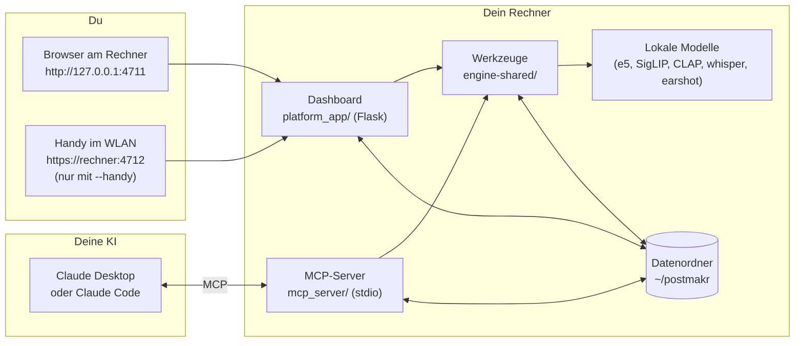
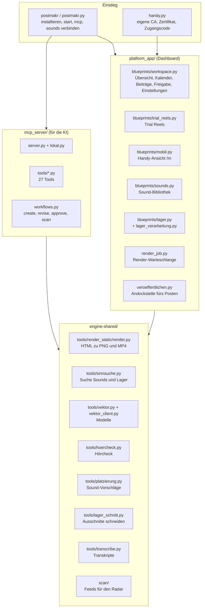
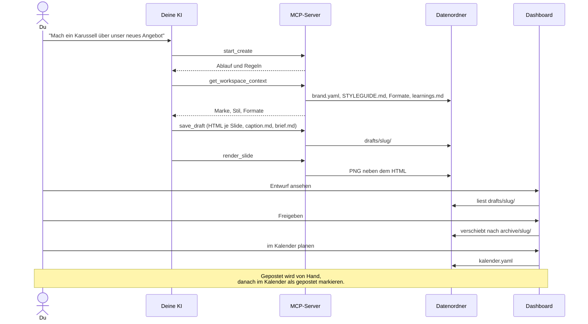
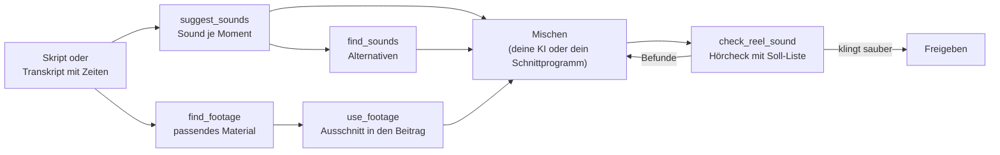
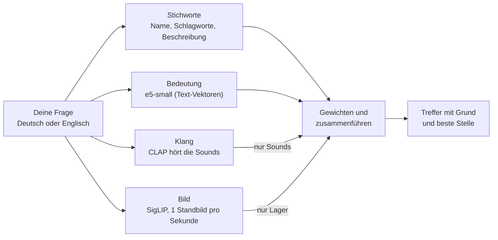

# Aufbau von postmakr lokal

Dieses Dokument erklärt, wie postmakr lokal gebaut ist: welche Teile es gibt,
wie sie zusammenspielen und wo welche Daten liegen. Die Grafiken sind in
Mermaid geschrieben, GitHub zeichnet sie direkt.

## 1. Systemüberblick

postmakr lokal besteht aus zwei Programmen, die beide auf deinem Rechner
laufen und denselben Datenordner benutzen: dem **Dashboard** für dich und dem
**MCP-Server** für deine KI. Die gemeinsame Werkzeugkiste `engine-shared/`
rendert Slides, sucht nach Bedeutung, hört Reels an und schneidet Clips.



Wichtig für das Verständnis:

- Es gibt keinen Server im Internet und keinen Login. Das Dashboard hört
  standardmäßig nur auf `127.0.0.1`.
- Dashboard und MCP reden nicht miteinander. Sie teilen sich nur die Dateien
  im Datenordner. Was die KI speichert, sieht das Dashboard beim nächsten
  Laden, und umgekehrt.
- Die Modelle laden beim ersten Gebrauch und laufen auf der CPU. Fehlen die
  Extras, fällt die Suche auf Stichworte zurück.

## 2. Bausteine im Repo



## 3. Ablauf: ein Beitrag entsteht

So arbeiten du und deine KI zusammen. Die KI schreibt die HTML-Quellen, du
prüfst im Dashboard und gibst frei. Gepostet wird von Hand oder über eine
Anbindung, die du dir selbst baust (siehe `platform_app/veroeffentlichen.py`).



## 4. Ablauf: ein Reel mit Sounds und Material



`suggest_sounds` endet mit einer Soll-Liste wie
`[{"nr": 1003, "zeit": 2.4}]`. Genau diese Liste gibt die KI nach dem Mischen
an `check_reel_sound` weiter. Der Hörcheck sucht jeden Sound im fertigen Mix
und meldet, ob er zu spät kommt, zu leise ist oder mitten in einem Wort liegt.

## 5. Der Datenordner

Standard ist `~/postmakr`, änderbar mit `POSTMAKR_DATEN`. Dashboard, MCP und
Startbefehl folgen derselben Regel: `WORKSPACES_DIR` gewinnt, sonst
`$POSTMAKR_DATEN/workspaces`, sonst `~/postmakr/workspaces`.

```text
~/postmakr/
├── .handy/                      CA, Zertifikat, Zugangscode (nur mit --handy, Rechte 0700)
└── workspaces/
    ├── .platform/
    │   ├── sounds/              Sounds für alle Workspaces (Nr. 1 bis 999), optional
    │   └── render_jobs/         Warteschlange des Renderers
    └── <workspace>/             ein Workspace pro Marke oder Projekt
        ├── brand.yaml           Name, Farben, Bereiche der Seitenleiste, Kanäle
        ├── context/
        │   ├── STYLEGUIDE.md    Tonalität und Gestaltung, liest die KI vor jeder Produktion
        │   ├── learnings.md     was funktioniert hat
        │   └── formats/*.md     ein Format pro Datei (Karussell, Sharepic, ...)
        ├── drafts/<slug>/       Entwürfe
        │   ├── meta.yaml        thema, format, datum, hook_gewinner, ...
        │   ├── caption.md       Haupt-Caption und Slide-Captions
        │   ├── brief.md         Idee, Quellen, Design-Entscheidungen
        │   └── assets/          slide1.html, slide1.png, slide1.mp4, ...
        ├── archive/<slug>/      freigegebene Beiträge, gleicher Aufbau
        ├── trials/<slug>/       Trial Reels
        │   ├── meta.yaml        titel, laenge, status, versionen[3] mit hook, oton, caption, aufnahmen
        │   └── v1/ v2/ v3/      Aufnahmen je Version
        ├── sounds/              eigene Sounds (ab Nr. 1001)
        │   ├── sounds.yaml      nr, datei, name, thema, stimmung, passt_zu, schlagworte, klang
        │   ├── 1001_name.mp3
        │   └── .index/          Suchindex (Vektoren), wird neu gebaut, wenn er fehlt
        ├── lager/<clip-id>/     Materiallager
        │   ├── meta.yaml        titel, regal, tags, beschreibung, auto (dauer, szenen, transkript)
        │   ├── original.*       die hochgeladene Datei
        │   ├── arbeit.*         Arbeitskopie für den Schnitt
        │   ├── vorschau.mp4, bogen.jpg, titelbild.jpg
        │   └── .index/          Bild- und Textindex
        ├── scan/                Radar: sources.yaml, backlog.yaml, results/
        ├── kalender.yaml        geplante und gepostete Termine
        └── .aktivitaet/journal.jsonl   was die KI über den MCP getan hat
```

Grundregeln für die Daten:

- **Die HTML-Dateien sind die Wahrheit.** PNG und MP4 sind abgeleitet und
  dürfen jederzeit neu gerendert werden.
- **Ein Beitrag ist ein Ordner.** Freigeben heißt: Der Ordner wandert von
  `drafts/` nach `archive/`.
- **Sounds werden über ihre Nummer angesprochen.** Nummern bleiben stabil,
  auch wenn Sounds dazukommen oder gelöscht werden.
- **Alles ist lesbarer Text** (YAML, Markdown, HTML). Du kannst jede Datei
  von Hand öffnen und ändern.

## 6. So funktioniert die Suche

Sounds und Material werden auf drei Wegen gefunden. Die Ergebnisse werden
gewichtet zusammengeführt, ein exakter Name steht immer vorne.



Die Bedeutung eines Sounds kommt aus seiner `sounds.yaml`. Je besser dort
Thema, Stimmung und Einsatz beschrieben sind, desto besser findet die Suche.
CLAP versteht nur englische Klangbeschreibungen, deshalb gibt es bei
`find_sounds` das eigene Feld `klingt_wie`.

## 7. Sicherheit ohne Login

Weil es keinen Login gibt, schützt sich das Dashboard anders:

- Es hört nur auf `127.0.0.1`, solange du nicht `--handy` angibst.
- Schreibende Anfragen müssen von einer erlaubten Adresse kommen
  (Origin-Prüfung). So kann keine fremde Webseite in deinem Browser Aktionen
  auslösen.
- Der Host-Name wird geprüft, damit niemand über einen Umweg auf das
  Dashboard zugreift.
- Mit `--handy` kommt aus dem Netz nur durch, wer den Zugangscode aus dem
  QR-Code hat.
- Der MCP-Server läuft über stdio. Im HTTP-Modus bindet er nur an `127.0.0.1`.
